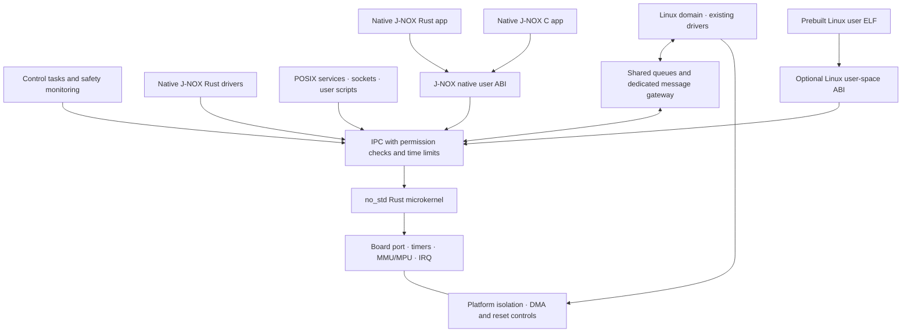

# Draft J-NOX Architecture

[한국어](architecture.md) · English

## DES-001 Microkernel

The privileged kernel manages address spaces, threads and scheduling, timers, exceptions, interrupts, permissions, and IPC. Explicit handles convey rights to communication endpoints, devices, and shared memory. The kernel validates handles, lengths, and permissions. It reserves safety-task resources at boot and bounds kernel memory allocation, wait times, and queue lengths during operation. Address protection uses the supported MMU or MPU. The design separates execute and write permissions and calls for verification of kernel and user stacks and exception paths.

The kernel uses `no_std` Rust. Safe Rust represents scheduler state, queues, and IPC state machines. Narrow modules contain `unsafe` operations for boot, context switching, MMIO, page tables, DMA, and FFI. Each block requires review of its preconditions and invariants for access rights, lifetimes, and synchronization. Control paths use static or bounded pools and return explicit errors. The configuration defines how to handle panics, stack exhaustion, and detected integrity faults. [Rust unsafe contracts](https://doc.rust-lang.org/book/ch20-01-unsafe-rust.html)

## DES-002 Linux driver domain

Linux runs in an independent execution domain with compatible drivers. One candidate arrangement for heterogeneous cores places J-NOX on R52 and Linux on A76. On AArch64 or x86-64 platforms where the domains share a CPU family, the project will compare verifiable static partitioning and hypervisor options. Each board requires a record of who controls memory, devices, interrupts, DMA, boot, and reset.

The driver runs against its original Linux module interface. Reuse depends on a compatible combination of Linux kernel, configuration, architecture, firmware, and device description. The first test will select a combination that can use the original module binary and verify its identity by hash. A separate Linux-side gateway and a J-NOX service connect to the existing device interface. This arrangement provides compatibility through Linux itself. [Linux internal driver API](https://docs.kernel.org/next/process/stable-api-nonsense.html)

Control messages carry a version, type, length, sequence number, expiry time, and restart generation. Communication uses fixed-size shared memory and limits the number of notifications. Initial ports will use a copy-based path to simplify verification. RPMsg/OpenAMP is a candidate transport for asymmetric multiprocessing (AMP). The safety gateway validates messages and discards expired data. After Linux restarts, the system reclaims queues, handles, and DMA ownership from the previous generation before reconnecting. An IOMMU/SMMU or board firewall limits device DMA. Assignment alongside safety functions requires evidence that the limit holds for the device. [Linux RPMsg](https://docs.kernel.org/staging/rpmsg.html) · [IOMMU and device isolation](https://docs.kernel.org/driver-api/vfio.html)

## DES-003 Threads and real-time scheduling

Each thread has a context, stack, priority, CPU affinity, and execution budget. Its process owns the address space and permissions. Verification proceeds in stages from multiple threads in one process to symmetric multiprocessing (SMP) across CPUs. The initial safety configuration uses fixed CPU assignments and a bounded thread count. The SMP synchronization contract defines lock ownership, lock ordering, maximum lock hold times, and behavior during cancellation, termination, and release.

| Policy | Plan |
| --- | --- |
| Fixed-priority preemption with FIFO ordering | The first policy selects the highest-priority ready thread and defines ordering among threads of equal priority. |
| Round robin at equal priority | Specify the time slice and compare its effects on interrupt latency and deadlines. |
| Static time partitions and CPU reservations | Limit CPU time per domain. Define budget-exhaustion notifications and overrun handling. |
| Deadline and sporadic scheduling | Candidates for an extended configuration. Use them in configurations with evidence for admission checks, overrun costs, and the effects of mixing policies. |

Select priority inheritance or a priority-ceiling protocol for each synchronization object. Analyze IPC priority propagation and bounds on nested waits. The fault response budget includes context switches, interrupt masking, and contention for shared memory and buses. Configurations that require load balancing or core migration need their own timing evidence.

## DES-004 Board and CPU ports

The common kernel has a separate port contract. Each port declares its capabilities for boot, context switching, MPU/MMU protection, address widths, pages and regions, timers, IRQs and interprocessor interrupts, core startup, caches, atomics and barriers, DMA isolation, and reset. The initial common test suite covers AArch64, R52 AArch32, and x86-64. MPU-based ports, including Cortex-M, specify the number of supported memory regions and actual isolation granularity. Pin board and firmware versions along with the CPU model.

## DES-005 User services and application APIs

The native API centers on synchronous request/reply, bounded queues, notifications, and shared memory. User libraries provide the selected subset of `pthread`, a monotonic clock, and APIs in the `socket` and `poll` families. Networking runs in a user process or the Linux domain. Planned stages add `AF_UNIX`, TCP and UDP over IPv4 and IPv6, multiple clients, nonblocking I/O, and readiness notification. The API matrix identifies features outside the selected POSIX scope. Extended filesystem features, dynamic linking, TLS, and packages will be evaluated for the extended configuration.

Native Rust is the default user application target of the J-NOX SDK. The kernel and user applications link as separate ELF files. The SDK provides versioned target and linker settings, user startup and exit code, `core`, and a safe user API crate. The first static AArch64 profile handles arguments, files and standard I/O without a heap. The syscall wrappers use the versioned J-NOX ABI. Qualify `alloc` with a user allocator and `std` with the OS support required by the standard library in separate tests.

The first native C profile targets AArch64. Its SDK rebuilds C sources as static ELF executables using the J-NOX target ABI, a sysroot with headers and libraries, startup code (`crt0`), libc, and linker settings. The libc maps a small POSIX subset to J-NOX services for opening, reading, writing, and closing authorized files, standard I/O, pipes, child process launch, and waiting for exit. The minimal shell's acceptance case is `cat sample.txt | wc -l`. It launches two external C executables, connects them with a pipe, and closes unused pipe ends so that `wc` receives EOF and prints the input file's line count.

Host scripts support builds and tests. Target scripts run in ordinary user services with limits on permissions, execution time, and memory. The Linux domain can provide Python and a shell. Lightweight native runtime candidates will be evaluated for J-NOX. Schedule and resource tables for the safety configuration become fixed, explicit build inputs after their format and value ranges are validated.

## DES-006 Safety monitoring and observability

The design covers deadline monitoring for control tasks and services, candidates for an independent watchdog, clock and reset monitoring, and bounded event recording. The state model defines normal operation, degraded operation, a product-specific safe state, and approved recovery conditions. Safety outputs are accessed through paths whose independence has been verified on the board. Where safety communication is required, document the requirements that justify sequence, timing, and integrity checks and the fault response. Each configuration also bounds CPU and memory use for trace storage and dumps.

## DES-007 Secure boot, access control, and supply chain

Design a chain of verification from the board's root of trust to the kernel and safety configuration, gateway, and updates. Define signing keys, separation of test and production keys, permitted versions, recovery slots, update transitions, and audit events. Other defenses include the kernel permissions model, independent resources for the safety domain, restricted management interfaces, pinned dependencies, and a software bill of materials (SBOM). Cryptographic functions use reviewed implementations and defined key-management boundaries.

## DES-008 Development and safety configuration baselines

Maintain links across planning, hazards, requirements, designs, changes, verification results, and release configuration hashes. Record the compiler, linker, libraries, and code generators for each target combination, along with evidence supporting confidence in those tools. Ferrocene is a candidate qualified toolchain. Compare the scope of qualification for the specific host, target, version, and libraries with the intended J-NOX use. Any gaps require use restrictions or further assessment. [Ferrocene qualification scope](https://public-docs.ferrocene.dev/main/safety-manual/scope.html) · [Target and library scope](https://public-docs.ferrocene.dev/main/user-manual/targets/index.html)

## DES-009 Native Rust driver SDK

Native J-NOX drivers run as isolated Rust services by default. The SDK supports permission-checked MMIO mappings, IRQ receipt and acknowledgement, DMA buffer allocation, mapping and reclamation, timers, request/reply, status queries, and restart procedures. The device manifest records the version, device ID, MMIO range, IRQs, and DMA limits. The shared-memory contract defines byte order, size, alignment, ownership transfer, and barriers. A virtual UART is the first native driver candidate. Verification of the DMA contract uses a separate DMA-capable device. Native device paths that serve a safety function carry product-specific assumptions and technical safety requirements.

## DES-010 Safety IPC channel

The first channel carries the periodic virtual-output permit in `ADR-001`. The safety sender protects the message and the safety receiver checks it before using it for control. Native IPC and a Linux-domain gateway share this contract. A relay forwards the protected message unchanged. The channel configuration binds the sending and receiving capability handles, direction, data ID and message type. The receiver checks the ID in the message against this configuration. [Bench decision](safety-parameters.en.md)

1. **Publication and transport.** The sender serializes the version, type, length, data ID, generation, sequence number, issue time and payload in a defined byte representation and computes an end-to-end CRC over all those bytes. Before implementation, the systems team fixes field widths, byte order, maximum length, CRC parameters and coverage, and reference test vectors. The channel uses a bounded, preallocated queue. When the queue is full, a new send returns a saturation result immediately and preserves the queued entries.
2. **Acceptance and rejection.** The receiver first checks endpoint permissions and transport slot bounds. It copies the input once into a private buffer, bounded by both the assigned slot and the channel maximum. Using only that snapshot, it checks the declared length, CRC, version, type, ID, current generation, exact next sequence number, issue time and payload range. It commits receiver state only after all checks pass. A frame rejected for corruption, duplication, reordering, a sequence gap, the wrong generation, expiry or any other failed check leaves the last valid data, its issue time and the recovery count unchanged. When opening a new generation, the supervisor sets the initial sequence number at both endpoints. Renew the generation before sequence rollover and inhibit the channel if a generation identifier could be reused.
3. **Timing and recovery.** The receiver monitors input loss on its own monotonic clock. On the bench, sender issue times are controlled inputs on the same virtual clock. A port across clock domains must establish timestamp provenance, synchronization uncertainty and a delay bound before accepting data as fresh. Bound the work per activation for examining slots, handling notifications and recording diagnostics so the expiry check still runs when the queue is empty, invalid traffic saturates it or Linux stops. Expiry takes precedence on the same tick. On disconnect or restart, invalidate queued frames and handles from the old generation. Apply the inhibition deadline and the conditions for rearming in a new generation from `ADR-001`.

The CRC detects accidental corruption in transit. Where the threat analysis requires authentication, the design must justify keyed endpoint authentication and replay protection. Even an authorized source can send a plausible but incorrect value. Using that value in a safety decision requires evidence about the source or independent plausibility checks. The Functional Safety Team reviews the product-specific fault model, residual error risk and timing budget. [AUTOSAR E2E protocol reference](https://www.autosar.org/fileadmin/standards/R25-11/FO/AUTOSAR_FO_PRS_E2EProtocol.pdf)

## DES-011 Direct execution through the Linux user-space ABI

The first target for `REQ-021` is a static AArch64 little-endian ELF64 Linux CLI running directly on J-NOX. Pin the provenance, version, hash, and options of one existing distribution binary that runs with ordinary user privileges. The first fixture is the Debian arm64 static BusyBox pinned by hash in the verification plan. The selected command is `wc -l sample.txt`. The ELF loader selects the native or Linux ABI from the approved launch manifest and checks the ELF class, byte order, machine, segment bounds, and permissions. The ELF `OSABI` field alone cannot distinguish the two profiles.

The Linux ABI contract defines initial stack alignment, `argc`, `argv`, `envp`, the auxiliary vector (`auxv`), and the selected libc's startup and exit requirements, including initial thread-local storage and thread pointer setup for `PT_TLS`. Audit the executable from launch through exit on reference Linux and freeze the syscall list, structure layouts, flags, and return values. Implement the AArch64 convention for `svc #0`, syscall number in `w8`, arguments in `x0`–`x5`, and result or negative errno in `x0`. Map each supported syscall number to a J-NOX service that checks capabilities and bounds sizes. An unimplemented call returns raw `-ENOSYS`. The first profile's loader rejects binaries that require `PT_INTERP`. A later dynamic profile requires qualification of the matching Linux interpreter, shared libraries, library symbol versions, and the ABI surface they exercise. [Linux syscall conventions](https://man7.org/linux/man-pages/man2/syscall.2.html) · [Linux execve and the ELF interpreter](https://man7.org/linux/man-pages/man2/execve.2.html)

The minimum safety configuration can omit the Linux user-space ABI service. Direct execution uses a non-safety user domain with CPU time, memory, and file descriptor limits. In `VER-021`, run the same hashed executable with the same arguments and input on reference Linux and J-NOX and compare output and exit status. A separate deployment can explicitly select a Linux guest with a matching ISA, kernel, user space, and any required interpreter and libraries. That guest receives its own resource budget. Run the direct-execution test with the guest disabled.

## DES-012 Scheduling policy layers

The kernel owns the ready queue and execution contexts. Selectors order eligible tasks. Budget, weighted-service and time-partition modules compute which task or group may run and for how long. The timer, preemption points, context restoration and protection boundaries have separate integration and acceptance steps. The minimum boot image and extended policy bench use different build profiles. [Policy scope and conditions](scheduling-policies.en.md) · [Round-robin execution test](m1-rr.en.md)

The sampled EDF/LLF profile accounts elapsed service to the designated incumbent and permits at most one involuntary switch at a grid boundary. Its evidence separates dispatch after completion from preemption of an active context. [Decision grid and tie rules](m1-deadline.en.md)

An aperiodic grant reserves a slot. Only a matching completion retires request work. Bounded FIFO and replenishment capacity have separate overload rules. [Server contract](m2-aperiodic.en.md)

## DES-013 IPC ownership and service boundaries

The kernel owns endpoint authority, wait and wake transitions, and bounded cross-domain transfer. User services own socket transports, publish/subscribe delivery and protocol-specific queues. The safety receiver checks protected data and controls expiry under DES-010. Each profile binds pool sizes, resource accounting, timeouts and restart generations before implementation. [IPC design and acceptance](ipc-mechanisms.en.md)

[Requirements](requirements.en.md) · [Verification plan](verification-plan.en.md) · [Development lifecycle](lifecycle.en.md)

The two-CPU QEMU configuration exercises fixed homes, global migration and singleton cluster enforcement. [Two-CPU scheduling](m3-smp.en.md)

The mutex configuration checks effective priority on real block, timer timeout and ownership handoff. [Mutex release cases](m1-mutex.en.md)

[Lottery and stride](m4-proportional.en.md) · [Weighted virtual runtime](m4-vruntime.en.md)

[EEVDF](m4-eevdf.en.md) · [Hierarchical groups](m4-hierarchy.en.md) · [Energy-aware placement](m3-power-placement.en.md) · [Bounded policy extension](m4-bounded-extension.en.md)

## Scheduling state transitions under test

The three single-CPU profiles below exercise queue order, periodic job generations and server replenishment. Each build selects one profile.

- POL-002 · CHG-029 · IMP-027 · [Fixed priority, queue order and remaining service](m1-priority-resume.en.md)
- POL-004 · CHG-030 · IMP-028 · [Periodic deadline misses and overlapping releases](m1-periodic-overrun.en.md)
- POL-004 · CHG-035 · IMP-033 · [Exact periodic pair](pol-004-exact-periodic.md)
- POL-008 · CHG-031 · IMP-029 · [Hard-CBS wakeup and deadline renewal](m2-cbs-wake.en.md)

## Linked Rust task configuration

CHG-032 / IMP-030 selects a single-core runtime and a static Rust task table at build time. The same kernel interface accepts FIFO and RR applications with different priorities and initial releases. EVD-030 calls for the first guest captures, task exception and stack checks, and terminal idle for each application configuration. [Fixed-priority runtime](fixed-runtime.en.md)

CHG-033 and IMP-031 select the ordinary FIFO/RR task tables on the P1 BCM2711 profile. Verification tracks the raw payload, model boot and physical observation separately. [Pi 4 linked-task runtime](boards/pi4-fixed-runtime.en.md)

CHG-034 and IMP-032 define two linked workloads for simultaneous release/expiry and overdue wakes after a bounded masked IRQ. Use ordinary execution and the optional diagnostic trace to reconstruct actual charged service. [Simultaneous and late timer events](fixed-runtime-edges.en.md)

POL-016 · CHG-040 · IMP-038 · [Ordinary nested groups](ordinary-groups.md#english) · [Debt and recovery EVD-038](evidence/evd-038.en.md)
