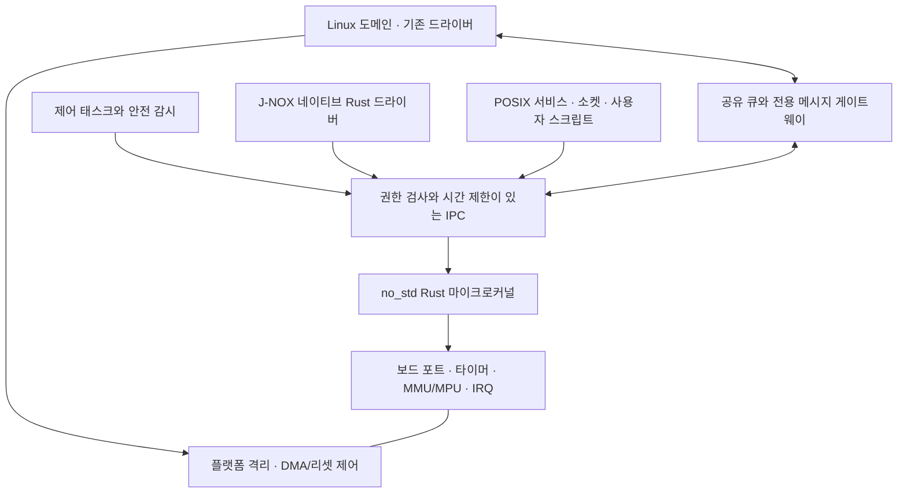

# J-NOX 아키텍처 초안

한국어 · [English](architecture.en.md)

## DES-001 마이크로커널

커널 특권 영역의 책임은 주소 공간, 스레드·스케줄링, 타이머·예외·인터럽트, 권한과 IPC다. 통신 엔드포인트, 장치, 공유 메모리에 대한 권한은 명시적 핸들로 넘긴다. 커널은 핸들·길이·권한을 검사한다. 안전 태스크의 자원은 부팅 시 확보하고, 운용 중 커널 메모리 할당과 대기·큐 길이에 상한을 둔다. 주소 보호는 지원되는 MMU 또는 MPU로 구현한다. 실행과 쓰기 권한을 분리하고, 커널과 사용자 스택 및 예외 경로를 검증한다.

커널은 `no_std` Rust를 사용한다. 스케줄러 상태, 큐와 IPC 상태 머신은 안전한 Rust로 표현한다. 부트 코드, 문맥 전환, MMIO, 페이지 테이블, DMA, FFI의 `unsafe`는 좁은 모듈에 모으고 각 블록의 전제와 권한·수명·동기화 불변식을 검토한다. 제어 경로에서 정적 또는 상한이 있는 풀과 명시적 오류 반환을 사용한다. 패닉, 스택 고갈과 검출된 무결성 오류에 대한 반응도 구성에서 결정한다. [Rust `unsafe` 계약](https://doc.rust-lang.org/book/ch20-01-unsafe-rust.html)

## DES-002 Linux 드라이버 도메인

Linux는 호환 드라이버가 설치된 독립 실행 영역으로 구동한다. 서로 다른 코어를 쓰는 후보는 R52에 J-NOX, A76에 Linux를 배치한다. 한 CPU 계열을 공유하는 AArch64/x86-64에서는 검증 가능한 정적 파티셔닝과 하이퍼바이저를 후보로 비교한다. 어느 방식이든 메모리, 장치, IRQ, DMA, 부트·리셋 권한의 실제 소유자를 보드별로 문서화한다.

드라이버는 원래의 Linux 모듈 인터페이스에서 실행한다. 이관 범위는 원본 드라이버와 호환되는 Linux 커널·설정·아키텍처·펌웨어·장치 기술 조합이다. 첫 시험에서는 원래 모듈 바이너리를 그대로 사용 가능한 조합을 선정하고 해시로 확인한다. 별도 Linux 측 게이트웨이와 J-NOX 서비스가 기존 장치 인터페이스를 연결한다. 자체 Linux 커널 API 호환 계층은 이 구조에 필요하지 않다. [Linux 내부 드라이버 API](https://docs.kernel.org/next/process/stable-api-nonsense.html)

제어 메시지는 버전, 타입, 길이, 순번, 유효 기한과 재시작 세대를 포함한다. 통신은 고정 크기 공유 영역과 제한된 알림 횟수를 사용한다. 초기 포트는 검증이 쉬운 복사 경로부터 시작한다. AMP에서는 RPMsg/OpenAMP를 전송 후보로 평가한다. 안전 게이트웨이는 메시지를 검증하고, 제한 시간을 넘은 데이터를 폐기한다. Linux 재시작 뒤에는 이전 세대의 큐·핸들·DMA 소유권을 회수한 뒤 재연결한다. 장치 DMA는 IOMMU/SMMU나 보드 방화벽으로 제한하며, 제한이 입증된 장치만 안전 인접 구성에 배정한다. [Linux RPMsg](https://docs.kernel.org/staging/rpmsg.html) · [IOMMU와 장치 격리](https://docs.kernel.org/driver-api/vfio.html)

## DES-003 스레드와 실시간 스케줄링

스레드별 문맥·스택·우선순위·CPU 친화도·실행 예산을 갖고, 프로세스가 주소 공간과 권한을 소유한다. 같은 프로세스의 멀티스레드와, 여러 CPU의 SMP를 단계별로 검증한다. 최초 안전 구성은 고정 CPU 배정과 상한이 있는 스레드 수를 사용한다. SMP 동기화에서 락의 소유·순서, 최대 잠금 시간, 취소·종료·해제 동작을 정의한다.

| 정책 | 계획 |
| --- | --- |
| 고정 우선순위 선점과 FIFO | 첫 정책. 준비된 최고 우선순위 스레드를 선택하고 같은 우선순위의 순서를 정의한다. |
| 같은 우선순위 라운드로빈 | 타임슬라이스를 명시하며 IRQ 지연과 기한 영향까지 비교한다. |
| 정적 시간 파티션과 CPU 예약 | 각 도메인에 CPU 시간 한도를 둔다. 예산 고갈 통지 및 초과 시 처리 규칙을 정한다. |
| 데드라인·스포래딕 정책 | 확장 후보. 등록 허용 검사, 초과 비용과 혼용 영향을 입증한 구성에서 적용한다. |

우선순위 상속 또는 우선순위 상한 정책을 동기화 객체별로 선택하고, IPC 우선순위 전달과 중첩 대기 한도를 분석한다. 고장 예산에 문맥 전환, IRQ 차단, 공유 메모리·버스 경쟁을 모두 포함한다. 로드 밸런싱이나 코어 이동이 필요한 구성은 시간 근거를 별도로 만든다.

## DES-004 보드와 CPU 포트

공통 커널과 포트 계약을 분리한다. 포트는 부팅, 문맥 전환, MPU/MMU, 주소 폭·페이지/영역, 타이머, IRQ/IPI, 코어 기동, 캐시·원자 연산·배리어, DMA 격리와 리셋 능력을 선언한다. AArch64, R52 AArch32, x86-64에 공통 시험 묶음을 먼저 적용한다. Cortex-M을 포함한 MPU 중심 포트는 지원하는 메모리 영역 수와 실제 격리 단위를 명시한다. CPU 이름과 별도로 보드 및 펌웨어 버전을 고정한다.

## DES-005 사용자 서비스와 앱 API

네이티브 API의 중심은 동기 요청·응답, 제한 큐, 알림과 공유 메모리다. 사용자 라이브러리가 `pthread`의 선정 범위, 단조 시계, `socket`·`poll` 계열 API를 제공한다. 네트워크 서비스는 사용자 프로세스나 Linux 도메인에 둔다. `AF_UNIX`, IPv4/IPv6의 TCP·UDP, 다중 클라이언트, 논블로킹 I/O와 준비 통지를 단계별로 제공한다. 선택한 POSIX 범위 밖은 API 매트릭스에 표시한다. 파일 서비스, ELF 로더 확장, TLS와 패키지는 확장 구성에서 필요성을 검토한다.

빌드와 시험에는 호스트 스크립트를 쓴다. 타깃 스크립트는 일반 사용자 서비스에서 권한·시간·메모리 상한을 적용한다. Python과 셸은 Linux 도메인에서 제공할 수 있고, J-NOX 네이티브 경량 런타임은 후보를 평가한다. 안전 구성의 스케줄·자원 표는 형식과 값 범위를 검증한 뒤 명시적인 빌드 입력으로 고정한다.

## DES-006 안전 감시와 관측

제어 태스크·서비스 기한 감시, 독립 watchdog 후보, 클록 및 리셋 감시, 제한된 이벤트 기록을 설계한다. 상태 전이는 정상, 저하, 제품별 안전 상태, 승인된 복구 조건으로 모델링한다. 보드별 독립성이 확인된 경로로 안전 출력에 접근한다. 안전 통신이 필요한 경우 시퀀스·시간·무결성 검증과 고장 반응을 해당 요구로 근거화한다. 추적 기록 저장 및 덤프의 CPU·메모리 사용량도 구성별로 제한한다.

## DES-007 보안 부트·권한·공급망

보드의 신뢰점에서 커널과 안전 구성, 게이트웨이, 업데이트까지 검증 사슬을 설계한다. 서명 키, 테스트·양산 키 분리, 허용 버전 정책, 복구 슬롯, 업데이트 전이와 감사 항목을 정의한다. 방어는 커널 권한 모델, 안전 영역의 독립 자원, 제한된 관리 인터페이스, 의존성 고정 및 SBOM으로 이어진다. 암호화 기능은 검토된 구현과 키 관리 경계를 사용한다.

## DES-008 개발과 안전 구성 기준선

기획·위험·요구·설계·변경·검증 결과와 릴리스 구성 해시를 이어 관리한다. 언어 선택과 별도로 컴파일러·링커·라이브러리·코드 생성기의 타깃 조합 및 신뢰 근거를 기록한다. Ferrocene은 자격 툴체인 후보다. 특정 호스트·타깃·버전 및 라이브러리의 자격 범위와 J-NOX 용도를 대조한다. 차이가 있으면 적용 제한 또는 추가 평가가 필요하다. [Ferrocene 자격 범위](https://public-docs.ferrocene.dev/main/safety-manual/scope.html) · [대상과 라이브러리 범위](https://public-docs.ferrocene.dev/main/user-manual/targets/index.html)

## DES-009 네이티브 Rust 드라이버 SDK

J-NOX 네이티브 드라이버는 기본적으로 격리된 Rust 서비스로 실행한다. SDK는 권한 검사가 있는 MMIO 매핑, IRQ 수신·승인, DMA 버퍼의 할당·맵·회수, 타이머, 요청·응답, 상태 질의와 재시작 절차를 지원한다. 장치 매니페스트에 버전, 장치 ID, MMIO 범위, IRQ와 DMA 한도를 기록한다. 공유 메모리는 바이트 순서, 크기, 정렬, 소유권 전이와 배리어를 계약으로 정의한다. 첫 네이티브 드라이버 후보는 가상 UART다. 실제 DMA 계약은 DMA 가능한 별도 장치에서 검증한다. 안전에 필요한 네이티브 장치 경로는 제품별 전제와 기술 안전 요구를 가진다.

[요구사항](requirements.md) · [검증 계획](verification-plan.md) · [개발 수명주기](lifecycle.md)
