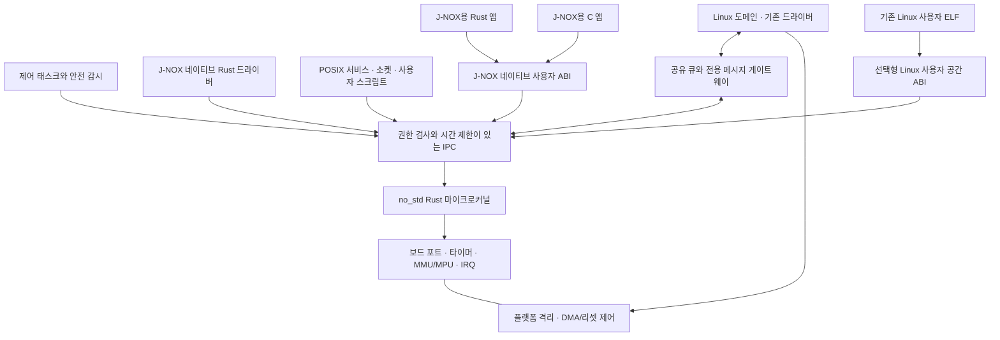

# J-NOX 아키텍처 초안

한국어 · [English](architecture.en.md)

## DES-001 마이크로커널

커널 특권 영역의 책임은 주소 공간, 스레드·스케줄링, 타이머·예외·인터럽트, 권한과 IPC다. 통신 엔드포인트, 장치, 공유 메모리에 대한 권한은 명시적 핸들로 넘긴다. 커널은 핸들·길이·권한을 검사한다. 안전 태스크의 자원은 부팅 시 확보하고, 운용 중 커널 메모리 할당과 대기·큐 길이에 상한을 둔다. 주소 보호는 지원되는 MMU 또는 MPU로 구현한다. 실행과 쓰기 권한을 분리하고, 커널과 사용자 스택 및 예외 경로를 검증한다.

커널은 `no_std` Rust를 사용한다. 스케줄러 상태, 큐와 IPC 상태 머신은 안전한 Rust로 표현한다. 부트 코드, 문맥 전환, MMIO, 페이지 테이블, DMA, FFI의 `unsafe`는 좁은 모듈에 모으고 각 블록의 전제와 권한·수명·동기화 불변식을 검토한다. 제어 경로에서 정적 또는 상한이 있는 풀과 명시적 오류 반환을 사용한다. 패닉, 스택 고갈과 검출된 무결성 오류에 대한 반응도 구성에서 결정한다. [Rust `unsafe` 계약](https://doc.rust-lang.org/book/ch20-01-unsafe-rust.html)

## DES-002 Linux 드라이버 도메인

Linux는 호환 드라이버가 설치된 독립 실행 영역으로 구동한다. 서로 다른 코어를 쓰는 후보는 R52에 J-NOX, A76에 Linux를 배치한다. 한 CPU 계열을 공유하는 AArch64/x86-64에서는 검증 가능한 정적 파티셔닝과 하이퍼바이저를 후보로 비교한다. 어느 방식이든 메모리, 장치, IRQ, DMA, 부트·리셋 권한의 실제 소유자를 보드별로 문서화한다.

드라이버는 원래의 Linux 모듈 인터페이스에서 실행한다. 이관 범위는 원본 드라이버와 호환되는 Linux 커널·설정·아키텍처·펌웨어·장치 기술 조합이다. 첫 시험에서는 원래 모듈 바이너리를 그대로 사용 가능한 조합을 선정하고 해시로 확인한다. 별도 Linux 측 게이트웨이와 J-NOX 서비스가 기존 장치 인터페이스를 연결한다. 자체 Linux 커널 API 호환 계층은 이 구조에 필요하지 않다. [Linux 내부 드라이버 API](https://docs.kernel.org/next/process/stable-api-nonsense.html)

제어 메시지는 버전, 타입, 길이, 순번, 유효 기한과 재시작 세대를 포함한다. 통신은 고정 크기 공유 영역과 제한된 알림 횟수를 사용한다. 초기 포트는 검증이 쉬운 복사 경로부터 시작한다. AMP에서는 RPMsg/OpenAMP를 전송 후보로 평가한다. 안전 게이트웨이는 메시지를 검증하고, 제한 시간을 넘은 데이터를 폐기한다. Linux 재시작 뒤에는 이전 세대의 큐·핸들·DMA 소유권을 회수한 뒤 재연결한다. 장치 DMA는 IOMMU/SMMU나 보드 방화벽으로 제한하며, 제한이 입증된 장치만 안전 인접 구성에 배정한다. [Linux RPMsg](https://docs.kernel.org/staging/rpmsg.html) · [IOMMU와 장치 격리](https://docs.kernel.org/driver-api/vfio.html)

## DES-003 스레드와 실시간 스케줄링

스레드별 문맥·스택·우선순위·CPU 친화도·실행 예산을 갖고, 프로세스가 주소 공간과 권한을 소유한다. 같은 프로세스의 멀티스레드와, 여러 CPU의 SMP를 단계별로 검증한다. 최초 안전 구성은 고정 CPU 배정과 상한이 있는 스레드 수를 사용한다. SMP 동기화에서 락의 소유·순서, 최대 잠금 시간, 취소·종료·해제 동작을 정의한다.

| 정책 | 계획 |
| --- | --- |
| 고정 우선순위 선점과 FIFO | 첫 정책. 준비된 최고 우선순위 스레드를 선택하고 같은 우선순위의 순서를 정의한다. |
| 같은 우선순위 라운드로빈 | 타임슬라이스를 명시하며 IRQ 지연과 기한 영향까지 비교한다. |
| 정적 시간 파티션과 CPU 예약 | 각 도메인에 CPU 시간 한도를 둔다. 예산 고갈 통지 및 초과 시 처리 규칙을 정한다. |
| 데드라인·스포래딕 정책 | 확장 후보. 등록 허용 검사, 초과 비용과 혼용 영향을 입증한 구성에서 적용한다. |

우선순위 상속 또는 우선순위 상한 정책을 동기화 객체별로 선택하고, IPC 우선순위 전달과 중첩 대기 한도를 분석한다. 고장 예산에 문맥 전환, IRQ 차단, 공유 메모리·버스 경쟁을 모두 포함한다. 로드 밸런싱이나 코어 이동이 필요한 구성은 시간 근거를 별도로 만든다.

## DES-004 보드와 CPU 포트

공통 커널과 포트 계약을 분리한다. 포트는 부팅, 문맥 전환, MPU/MMU, 주소 폭·페이지/영역, 타이머, IRQ/IPI, 코어 기동, 캐시·원자 연산·배리어, DMA 격리와 리셋 능력을 선언한다. AArch64, R52 AArch32, x86-64에 공통 시험 묶음을 먼저 적용한다. Cortex-M을 포함한 MPU 중심 포트는 지원하는 메모리 영역 수와 실제 격리 단위를 명시한다. CPU 이름과 별도로 보드 및 펌웨어 버전을 고정한다.

## DES-005 사용자 서비스와 앱 API

네이티브 API의 중심은 동기 요청·응답, 제한 큐, 알림과 공유 메모리다. 사용자 라이브러리가 `pthread`의 선정 범위, 단조 시계, `socket`·`poll` 계열 API를 제공한다. 네트워크 서비스는 사용자 프로세스나 Linux 도메인에 둔다. `AF_UNIX`, IPv4/IPv6의 TCP·UDP, 다중 클라이언트, 논블로킹 I/O와 준비 통지를 단계별로 제공한다. 선택한 POSIX 범위 밖은 API 매트릭스에 표시한다. 파일시스템 확장, 동적 링크, TLS와 패키지는 확장 구성에서 필요성을 검토한다.

네이티브 Rust는 J-NOX SDK의 기본 사용자 앱 타깃이다. 커널과 사용자 앱은 별도 ELF로 링크한다. SDK는 버전이 명시된 타깃·링커 설정, 사용자 시작·종료 코드, `core`와 안전한 사용자 API 크레이트를 제공한다. 첫 AArch64 정적 프로파일은 힙 없이 인수·파일·표준 입출력을 처리한다. 시스템 호출 래퍼는 버전이 명시된 J-NOX ABI를 사용한다. `alloc`은 사용자 할당기, `std`는 표준 라이브러리의 OS 지원을 갖춘 뒤 별도 시험한다.

첫 네이티브 C 프로파일은 AArch64를 대상으로 한다. SDK의 J-NOX 타깃 ABI, 헤더·라이브러리를 담은 sysroot, 시작 코드(`crt0`), libc와 링커 설정으로 C 소스를 정적 ELF 실행 파일로 다시 빌드한다. libc는 허용된 파일의 열기·읽기·쓰기·닫기, 표준 입출력, 파이프, 자식 프로세스 실행·대기를 J-NOX 서비스에 연결한다. 최소 셸의 인수 기준은 `cat sample.txt | wc -l`이다. 셸이 외부 C 실행 파일 두 개를 띄우고 파이프를 연결해 사용하지 않는 끝을 닫으면, `wc`가 EOF를 받아 입력 파일의 줄 수를 출력해야 한다.

빌드와 시험에는 호스트 스크립트를 쓴다. 타깃 스크립트는 일반 사용자 서비스에서 권한·시간·메모리 상한을 적용한다. Python과 셸은 Linux 도메인에서 제공할 수 있고, J-NOX 네이티브 경량 런타임은 후보를 평가한다. 안전 구성의 스케줄·자원 표는 형식과 값 범위를 검증한 뒤 명시적인 빌드 입력으로 고정한다.

## DES-006 안전 감시와 관측

제어 태스크·서비스 기한 감시, 독립 watchdog 후보, 클록 및 리셋 감시, 제한된 이벤트 기록을 설계한다. 상태 전이는 정상, 저하, 제품별 안전 상태, 승인된 복구 조건으로 모델링한다. 보드별 독립성이 확인된 경로로 안전 출력에 접근한다. 안전 통신이 필요한 경우 시퀀스·시간·무결성 검증과 고장 반응을 해당 요구로 근거화한다. 추적 기록 저장 및 덤프의 CPU·메모리 사용량도 구성별로 제한한다.

## DES-007 보안 부트·권한·공급망

보드의 신뢰점에서 커널과 안전 구성, 게이트웨이, 업데이트까지 검증 사슬을 설계한다. 서명 키, 테스트·양산 키 분리, 허용 버전 정책, 복구 슬롯, 업데이트 전이와 감사 항목을 정의한다. 방어는 커널 권한 모델, 안전 영역의 독립 자원, 제한된 관리 인터페이스, 의존성 고정 및 SBOM으로 이어진다. 암호화 기능은 검토된 구현과 키 관리 경계를 사용한다.

## DES-008 개발과 안전 구성 기준선

기획·위험·요구·설계·변경·검증 결과와 릴리스 구성 해시를 이어 관리한다. 언어 선택과 별도로 컴파일러·링커·라이브러리·코드 생성기의 타깃 조합 및 신뢰 근거를 기록한다. Ferrocene은 자격 툴체인 후보다. 특정 호스트·타깃·버전 및 라이브러리의 자격 범위와 J-NOX 용도를 대조한다. 차이가 있으면 적용 제한 또는 추가 평가가 필요하다. [Ferrocene 자격 범위](https://public-docs.ferrocene.dev/main/safety-manual/scope.html) · [대상과 라이브러리 범위](https://public-docs.ferrocene.dev/main/user-manual/targets/index.html)

## DES-009 네이티브 Rust 드라이버 SDK

J-NOX 네이티브 드라이버는 기본적으로 격리된 Rust 서비스로 실행한다. SDK는 권한 검사가 있는 MMIO 매핑, IRQ 수신·승인, DMA 버퍼의 할당·맵·회수, 타이머, 요청·응답, 상태 질의와 재시작 절차를 지원한다. 장치 매니페스트에 버전, 장치 ID, MMIO 범위, IRQ와 DMA 한도를 기록한다. 공유 메모리는 바이트 순서, 크기, 정렬, 소유권 전이와 배리어를 계약으로 정의한다. 첫 네이티브 드라이버 후보는 가상 UART다. 실제 DMA 계약은 DMA 가능한 별도 장치에서 검증한다. 안전에 필요한 네이티브 장치 경로는 제품별 전제와 기술 안전 요구를 가진다.

## DES-010 안전 IPC 채널

첫 채널은 `ADR-001`의 주기적 가상 출력 허가를 전달한다. 안전 송신 종단이 메시지를 보호하고 안전 수신 종단이 제어에 쓰기 전에 검사한다. 네이티브 IPC와 Linux 도메인 게이트웨이 양쪽에 같은 계약을 적용한다. 중계기는 보호된 메시지를 그대로 전달한다. 채널 설정은 송신·수신 권한 핸들, 방향, 데이터 ID와 메시지 타입을 결합한다. 수신기는 메시지에 적힌 ID를 채널 설정과 대조한다. [벤치 결정](safety-parameters.md)

1. **발행과 전달.** 송신 종단이 버전·타입·길이·데이터 ID·세대·순번·발행 시각·페이로드를 고정된 바이트 표현으로 직렬화하고 이 전체에 종단 간 CRC를 계산한다. 시스템팀은 구현 전에 필드 폭·바이트 순서·최대 길이, CRC 파라미터·검사 범위·기준 시험 벡터를 고정한다. 채널은 사전 할당한 유한 큐를 쓴다. 큐가 차면 새 전송은 즉시 포화 결과를 반환하고 기존 항목을 보존한다.
2. **수신과 폐기.** 수신기는 엔드포인트 권한과 전송 슬롯의 경계를 먼저 확인한다. 할당된 슬롯과 채널 상한 안에서 데이터를 전용 버퍼로 한 번 복사한다. 그 복사본만 사용하여 내부 길이, CRC, 버전·타입·ID, 현재 세대, 다음 연속 순번, 발행 시각과 값 범위를 검사한다. 모든 검사를 통과해야 상태를 한 번에 갱신한다. 손상·중복·역순·순번 누락·잘못된 세대·만료 등으로 거부한 프레임은 마지막 유효 데이터, 그 발행 시각, 복구 계수를 바꾸지 않는다. 감독자는 새 세대를 열 때 초기 순번을 양 종단에 설정한다. 순번 롤오버 전에 세대를 교체하고, 세대 식별자 재사용 가능성이 있으면 채널을 차단한다.
3. **시간과 복구.** 수신기는 자체 단조 시계로 입력 상실을 감시한다. 벤치에서는 송신 발행 시각도 같은 가상 시계의 통제된 입력이다. 다른 시계 도메인의 포트는 시각 출처·동기 오차·지연 상한을 입증한 뒤 신선도 판정을 허용한다. 슬롯 검사·알림·진단 처리에 실행당 상한을 두어 빈 큐, 불량 프레임 폭주 또는 Linux 정지 중에도 만료 검사가 실행되게 한다. 동일 틱에서는 만료를 먼저 판정한다. 연결 종료·재시작 시 기존 세대의 대기 프레임과 핸들을 무효화한다. 새 세대에서 출력을 재허가하는 조건과 차단 기한은 `ADR-001`을 따른다.

CRC의 역할은 전송 중 우발적 손상 검출이다. 위협 분석상 인증이 필요한 경로는 키가 있는 종단 인증과 재전송 방지 근거를 갖춰야 한다. 권한을 가진 송신원도 그럴듯한 잘못된 값을 보낼 수 있다. 해당 값을 안전 판단에 사용할 때는 출처에 대한 안전 근거나 독립된 타당성 검사를 요구한다. 제품별 오류 모델, 잔여 오류 가능성과 시간 예산은 기능안전팀이 검토한다. [AUTOSAR E2E 프로토콜 참고 자료](https://www.autosar.org/fileadmin/standards/R25-11/FO/AUTOSAR_FO_PRS_E2EProtocol.pdf)

## DES-011 Linux 사용자 공간 ABI 직접 실행

`REQ-021`의 첫 대상은 J-NOX 위에서 직접 실행할 AArch64 리틀엔디언 ELF64 정적 Linux CLI다. 일반 사용자 권한으로 동작하는 기존 배포 바이너리 하나의 출처·버전·해시·옵션을 고정한다. 첫 시료는 검증 계획에 해시를 기록한 Debian arm64 정적 BusyBox이며, 선정한 명령은 `wc -l sample.txt`다. ELF 로더는 승인된 실행 명세에서 네이티브 ABI 또는 Linux ABI를 선택하고 ELF 클래스·바이트 순서·기계 종류·세그먼트 경계와 권한을 검증한다. 공통으로 쓰일 수 있는 ELF `OSABI` 값 하나로 ABI를 판정할 수 없다.

Linux ABI 실행 경로는 초기 스택 정렬, `argc`·`argv`·`envp`·보조 벡터(`auxv`)와 선정한 libc의 시작·종료 시 요구 동작과 `PT_TLS`의 초기 스레드 저장소·스레드 포인터 설정을 규정한다. 참조 Linux에서 시작부터 종료까지 조사해 호출 목록과 구조체 배치, 플래그, 반환값을 고정한다. AArch64의 `svc #0`, 호출 번호(`w8`), 인수(`x0`–`x5`), 결과 또는 음의 errno(`x0`)를 따르며, 각 번호를 권한 검사와 크기 상한이 있는 J-NOX 서비스에 연결한다. 미구현 호출에는 원시 `-ENOSYS`를 반환한다. 첫 프로파일의 로더는 `PT_INTERP`를 요구하는 파일을 거부한다. 동적 실행에는 해당 Linux 인터프리터·공유 라이브러리·심볼 버전과 그 ABI 범위를 추가로 검증해야 한다. [Linux syscall 규약](https://man7.org/linux/man-pages/man2/syscall.2.html) · [Linux execve와 ELF 인터프리터](https://man7.org/linux/man-pages/man2/execve.2.html)

최소 안전 구성에서는 Linux 사용자 공간 ABI 서비스를 제외할 수 있다. 직접 실행 프로세스는 비안전 사용자 도메인에 두고 CPU 시간·메모리·파일 디스크립터 사용량에 상한을 둔다. `VER-021`에서는 같은 해시의 실행 파일에 같은 인수·입력을 주고 참조 Linux와 J-NOX에서 출력·종료 상태를 비교한다. 별도 선택 사항으로 사용자가 Linux 게스트를 명시해 해당 ISA·커널·사용자 공간과 필요한 인터프리터·라이브러리를 갖춘 환경에서 기존 CLI를 실행할 수 있다. 게스트에는 별도의 자원 예산을 적용하며 직접 실행 시험은 게스트를 끈 상태에서 수행한다.

## DES-012 스케줄링 정책 계층

준비 큐와 실행 문맥은 커널이 소유한다. 선택기는 실행 가능한 태스크의 순서를 정하고, 예산·가중 서비스·시간 분할 모듈은 어느 태스크나 그룹이 얼마 동안 실행 가능한지 계산한다. 타이머, 선점 지점, 문맥 복원과 보호 경계는 별도로 연결하고 판정한다. 최소 부팅 이미지와 확장 정책 벤치는 빌드 구성이 다르다. [정책 범위 및 적용 조건](scheduling-policies.md) · [라운드로빈 실행 시험](m1-rr.md)

EDF·LLF 시간 격자 구성은 실행 중인 작업에 경과 시간을 차감하고, 같은 결정 경계에서 비자발적 전환을 최대 한 번 허용한다. 완료 직후 다음 작업을 고르는 경로와 현재 작업을 선점하는 경로를 구별해 기록한다. [시간 격자와 동점 규칙](m1-deadline.md)

## DES-013 IPC 소유권과 서비스 경계

커널은 종단 권한, 대기·깨우기 상태 전이와 한도가 정해진 도메인 간 전달을 담당한다. 소켓 전송, 발행·구독 전달과 프로토콜별 큐는 사용자 서비스가 소유한다. 안전 수신기는 DES-010에 따라 보호 데이터를 검증하고 만료 시점을 판단한다. 구현 전에 프로파일별 풀 크기, 자원 회계, 시간 초과와 재시작 세대를 정한다. [IPC 설계와 인수 시험](ipc-mechanisms.md)

[요구사항](requirements.md) · [검증 계획](verification-plan.md) · [개발 수명주기](lifecycle.md)
