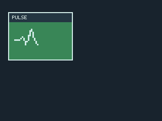
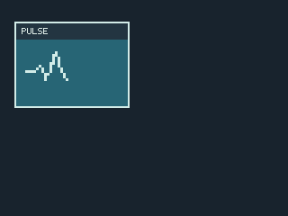

# EVD-343 · Native tablet recovery

The primary compositor owned the virtual tablet when the redrawing client received a button press. The compositor then faulted while the button remained down. The kernel retired the owner and both device queues, and the spare acquired a new device generation. After the client reconnected, the release of the old button reached the DMA ring and produced zero button events on the new Wayland connection. A fresh click at surface-local (64, 46) produced a press and release, a redraw and the expected external pixels. The independent reader checked the wire, DMA bytes and process memory against the captured framebuffer. [Recovery receipts](recover.json) · [Second compositor fault](double-fault.json)

All four cold boots used the same AArch64 QEMU kernel. Its SHA-256 is `d2a768fb08fa983ba8d323a6fa86352557a5046c76a7bd6906c340135cf1c37c`. The build checkout `5a61919856e43b453cfb1eeb2a59cb1a8fd04e8a` and the [published source](https://github.com/Romanof123/JNOX/tree/a2ac6718eec0c3012bb012a60bc5f16ecc5ced83) have the identical Git tree `69b91ea04ec9463fbb9dca45943fd87d182a2a40`.

| Same five-role image | Controller completions | Longest whole-run gap | Longest recovery-window gap | Fault to first new frame, upper bound |
| --- | ---: | ---: | ---: | ---: |
| Primary fault, spare exits cleanly | 4,096 | 10.259744 ms | 10.112912 ms | 130.058544 ms |
| Primary and spare fault | 4,096 | 10.622160 ms | 10.622160 ms | 140.006944 ms |
| Clean primary exit | 4,096 | 12.587504 ms | — | — |
| No tablet, keyboard redraw | 4,096 | 10.309008 ms | — | — |

The controller requested 10 ms absolute releases. No measured consecutive completion interval exceeded the declared 20 ms limit. The frame bounds enclose the first observed frame using controller samples on either side. The no-tablet case tested a keyboard redraw and clean shutdown. [Timing details](summary.json) · [Clean exit](clean.json) · [No tablet](absent.json)

The first SDK build failed at the signed 64-bit type used for denial receipts. A subsequent sparse checkout omitted the controller's existing clock header. Both were corrected before the four captures. The first independent reader expected three generic device denials. The pointer-enabled caller records five, including separately checked acquisition and read denials. After correcting this assumption, the reader rejected all seven altered inputs. A separate host model of the Rust reset module returned an error and preserved DMA storage in all three stuck-register cases. Acknowledgement on the last permitted poll reclaimed exactly once. [Altered-data results](controls.json) · [Reset model](reset-model.json) · [Acceptance and regressions](https://github.com/Romanof123/JNOX/issues/457)

## Other profiles / 구성별 회귀 시험

Three separately packaged regressions used the same source. The ordinary four-process tablet image passed the click, focus, redraw, cleanup and process-exit checks. A keyboard-only five-role image retained keyboard capability before and after reconnect, observed EOF on the old connection, and completed all 4,096 releases with a maximum interval of 10.585296 ms. A headless image ran the controller alone, exited 74 and completed all 4,096 releases with a maximum interval of 10.271312 ms. Its device tree and kernel image excluded the display and tablet. The initial headless package omitted its FIFO priority. The first reader expected an optional manifest entry and the corrected reader used the captured single-process page tables in the same boot. [Per-profile identities and results](regressions.json)

태블릿 기본 구성, 키보드 전용 합성기 복구, 화면 없는 단일 제어 앱까지 같은 소스에서 각각 회귀 시험했다. 키보드 전용과 헤드리스 구성의 제어 완료 간격은 모두 20 ms 이내였다.

## Display captures / 게스트 화면

| Button held in the primary | Spare ready after reconnect | Fresh press at the spare |
| --- | --- | --- |
|  |  |  |

The release verifier restored 197 locally retained files, including 25 complete guest RAM snapshots, into a fresh directory and compared the four capture trees byte for byte. The retained local archive is 6,765,821 bytes with SHA-256 `7ca42a6c968920d62773f5fc4ab04d1779754ea3179cbcf9cbf47a35be9a9b6c`. These three public PNGs reproduce the external framebuffer RGB bytes at the named checkpoints. / 원본 메모리와 장치 기록은 로컬에서 복원·대조했다. 공개 화면에는 각 시점의 게스트 프레임버퍼 픽셀을 담았다. [Frame hashes / 화면 해시](previews/frames.json)

## 한국어

주 합성기가 태블릿 버튼을 누른 채 고장 난 뒤 두 장치 큐를 회수하고 예비 합성기가 새 세대로 장치를 인수했다. 이전 누름의 해제는 DMA에서 관찰됐지만 새 Wayland 연결에는 전달되지 않았다. 예비 합성기에서 새 클릭을 보내 클라이언트의 누름·해제, 화면 갱신, 실제 출력 픽셀을 독립 대조했다. 태블릿이 없는 구성에서는 키보드로 화면을 갱신하고 정상 종료했다.

같은 커널로 네 번 부팅해 제어 태스크 완료 시각 16,384개를 확인했다. 선언한 20 ms 간격을 넘긴 사례는 없었다. 새 화면을 관찰하기까지의 두 상한은 각각 130.059 ms와 140.007 ms였다. 이 시간은 가상 머신의 해당 실행에서 관측한 값이다. 실물 장치 복구 시간과 제품 안전 기한은 별도 검증 대상이다.
