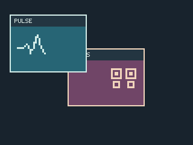
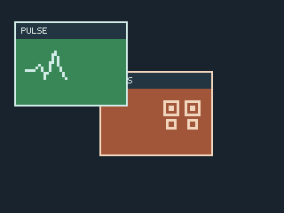
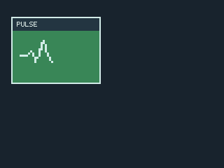

# EVD-341 · Tablet input and retirement / 태블릿 입력과 장치 회수

## Corrected guest result / 수정본 결과

Both cold boots of source `560bcb768e6287da8732c2e81a9a4ece166ba9f6` passed independent device, input, wire-order, frame and normal-retirement checks. In each of three focus transitions the previous surface's leave was sent before the new surface's enter. Both apps received and reacted to a real click. After the focused client exited, the remaining app received fresh motion. Both queue-ready readbacks were zero after device retirement. Device absence, keyboard-only and headless profiles passed. Thirty intentionally altered inputs were rejected. The host additionally exercised an explicit surface destruction while the peer connection stayed open. [Independent results and controls](corrected/CORRECTED.md) · [Corrected raw replay archive](corrected/corrected-560bcb7-replay.zip) · [Fresh archive verification](corrected/corrected-archive-readback.json)

The corrected raw archive is 1,016,691 bytes with SHA-256 `57c96d203bafcfb0775c373d9c323f6b5e7b85ed0a36143916866da2a1f38214`. The ordinary profile retires the device on owner exit. Reassigning a tablet to the standby after an active compositor fault is a separate integration experiment. [Recovery integration #457](https://github.com/Romanof123/JNOX/issues/457)

수정본을 두 번 부팅해 두 방향의 포커스 전환과 창 겹침 순서 변경 모두에서 이탈 후 진입이 실제 소켓으로 전송되는지 확인했다. 손상 대조 30건을 거부했고 배포할 원본을 새 디렉터리에 풀어 재현했다. 고장 난 합성기에서 예비 합성기로의 태블릿 인계는 #457에서 추적한다.

## Original failing revision / 최초 실패 원본

JNOX source `1feb5b1f4773486dd6c92edae74af740e9fcbf22`. The four-process QEMU virt image ran two clients, a compositor and the local socket broker. Only the compositor could acquire or read the virtio-input device. The QMP device list and launch arguments identify the selected absolute tablet. An independent reader found a cross-client focus-order failure on this revision. [Acceptance #451](https://github.com/Romanof123/JNOX/issues/451) · [Capture summary](summary.json) · [QMP device](mice.json)

| Before input | After one click in each window | After the focused client exited |
| --- | --- | --- |
|  |  |  |

The final attached-device boot recorded 24 completed queue entries and ten SYN_REPORT boundaries. Two apps received their own button press and release. After the focused client exited the survivor received local motion at (114, 76). Both clients were denied direct device probe and read. At owner exit the device status and each queue's selected QueueReady register read zero, and 8,192 bytes of reserved DMA storage had been cleared. The post-exit observer selected each inactive queue separately with the CPU stopped. [Both raw queue readbacks](retired-queue-ready.json) · [Retired device status](terminal.device.json)

The initial runner mistakenly treated a trailing carriage return in the device mode as an absent device. Two early boots exercised that path. The corrected runner requires a recognized mode. Device-present, device-absent, keyboard-only and strictly headless configurations were then exercised separately.

**Protocol finding.** On a transition from Tiles to Pulse the outgoing packet journal recorded the new enter at sequence 59 and the old leave at sequence 60, although the serial numbers had been allocated in the required order. The cross-client send order failed. These captures preserve the original behavior. Compositor crash replacement with the tablet attached has separate scope from this ordinary owner-exit measurement. [Wayland pointer leave](https://wayland.freedesktop.org/docs/html/apa.html#protocol-spec-wl_pointer-event-leave)

게스트에서 태블릿 입력, 두 창의 클릭과 화면 변화, 비소유자 접근 거부, 기존 소유자 종료 후 두 큐와 DMA 저장 공간 회수를 관측했다. 단, 겹친 창으로 포인터를 이동할 때 기존 창 이탈보다 새 창 진입을 먼저 전송한 사례가 확인됐다. 이 커밋의 전송 순서는 실패로 기록하며 수정본은 새로운 부팅에서 검증한다.

The independent reader reproduced the reversed send order and rejected ten altered inputs. Download the [original raw archive](first-review/original-1feb5b1-replay.zip) (SHA-256 `cc374c3f7a7e0700bf24d368b4d8842751cd04c2154509e1ea1b3ae19603471a`). Instructions include the absent-tablet, keyboard-only and headless controls. The six original injected click/motion packets have raw DMA snapshots for all 14 corresponding entries. Terminal counters include the ten later entries associated with focus changes and client departure. [Replay instructions and observation limits](first-review/README.md)
