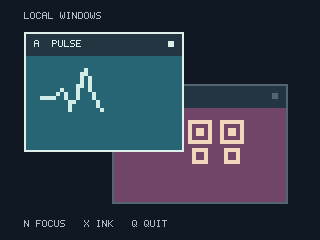
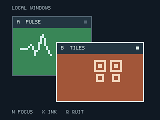

# Two local Rust windows on AArch64 JNOX / AArch64 JNOX 로컬 창 두 개

Two Rust apps drew overlapping windows and responded to focus changes in one QEMU virt guest. The display service and both apps ran in JNOX, connected through the existing JNOX AF_UNIX broker. This example uses a native drawing protocol. The earlier X11 demonstration uses an external X server. [Design and acceptance](../native-window-pair.en-ko.md) · [Build or run it](../../examples/native-window-pair/README.md) · [#413](https://github.com/Romanof123/JNOX/issues/413)

한 번 부팅한 가상 보드에서 두 Rust 앱이 각각 그리기 데이터를 보냈고, JNOX 화면 서비스가 두 창을 겹쳐 그렸다. 키를 누르면 포커스된 앱만 색을 바꿨다. 이번에는 화면 합성과 입력 전달이 모두 게스트 안에서 이뤄졌다.

| Pulse in front / Pulse 활성 | Tiles in front after input / 입력 후 Tiles 활성 |
| --- | --- |
|  |  |

## Observed behavior / 검증 결과

| Serial input / 시리얼 입력 | Observed guest screen / 실제 게스트 화면 |
| --- | --- |
| Boot / 부팅 | Pulse in front with a teal body. Tiles behind it in plum. / 청록색 Pulse 창이 자주색 Tiles 창 앞에 표시됨. |
| `x` | Pulse changed to green. Tiles kept its content. / Pulse만 초록색으로 바뀜. |
| `n` | Tiles received focus and covered Pulse in the overlap. / 포커스가 Tiles로 이동하고 겹친 부분에서 Tiles가 앞에 표시됨. |
| `x` | Tiles changed to copper. Pulse stayed green. / Tiles만 구릿빛으로 바뀜. |
| `q` | Both apps acknowledged their final action counts. Each handled one action, Pulse with serial 1 and Tiles with serial 2. / 두 앱이 각각 한 번의 입력을 처리했음을 확인한 뒤 종료함. |

The independent observer read the actual 320 × 240 QEMU scanout twice per state. All 76,800 pixels in each of eight captures matched the expected image. The guest ran on one emulated Cortex-A72 with four private process address spaces. Display owner, Pulse, Tiles and broker returned their expected exit codes in slot order (`70, 71, 72, 0`). Both apps required permission denial on all three direct device calls before they could complete. Their drawing data and acknowledgements travelled over ordinary local sockets. The scheduler trace retained 128 entries and reported 1,509 dropped entries. The UART exit records and external scanout were captured separately. QEMU logged a missing optional ramfb VGA ROM. The native driver initialized scanout through fw_cfg, and QMP returned all eight expected frames.

네 화면 상태를 QEMU에서 두 번씩 읽어 매번 전체 픽셀을 대조했다. 두 앱 모두 화면 초기화, 한 줄 출력, 입력 읽기에 직접 접근하면 권한 오류를 받았다. 스케줄러 기록은 128건을 보존하고 1,509건이 넘쳐 유실됐다. 시리얼 종료 기록과 화면 원본은 별도로 보존했다. 실물 디스플레이, 안전 태스크와의 시간 간섭, 제품 안전 승인은 별도 범위다.

Three further cold boots on the same source passed the existing display controls. In the two-process configuration the owner reacted to serial input and the other process was denied (`0, 61`). Removing the ramfb device produced the expected no-device outcome (`19, 61`). A headless image without display services returned the unsupported outcome (`38`). Three host selector test groups covered accepted and rejected package configurations. / 같은 소스에서 기존 화면·장치 미장착·헤드리스 구성의 세 부팅도 통과했다.

## Evidence and scope / 증거와 범위

- **EVD-318** covers CHG-318 and IMP-318 for REQ-015/024, DES-009/013, VER-015/024. The source compiled locally at `f8369c4682eadb0656c21dac39a8cceb4008dd03` has the same Git tree (`70d19f33f1a0a59187bff0ef5b3f25729cd105e4`) as the [published source](https://github.com/Romanof123/JNOX/commit/95ab33dd5358fd58f4f59b70d4ed049aa8c0d397). The four-process kernel SHA-256 is `8d8fbfd313e2b999dd2e1d00e35b942ffaff83dec2c0a1ac9e1958c618cf21d8`. / 검증 이미지의 해시와 로컬·공개 커밋의 동일 소스 트리를 원본에 연결했다.
- [Original capture, boot images, sources and replay](native-window-pair.tar.xz). Extract the archive and run `python3 replay.py` and then `python3 regression.py` from the extracted root with Python 3.9 or newer. SHA-256 `b7c20d9365b3f7c751f4a148702c0537fbb9a63146340d4572b5b2149ad4f8c4`. The replay checks the original screens, source and binary identities, UART and five corruption controls. For a new guest run, use the example build instructions above. / 원본을 풀고 같은 위치에서 리플레이 명령을 실행하면 화면·입력·종료 기록을 다시 대조할 수 있다.
- The demo uses bounded drawing records and serial keys. Standard Wayland clients, shared-memory buffers and descriptor transfer, focus via physical input, client death and compositor recovery, resident Xwayland and physical-board measurements remain open. / 표준 Wayland·Xwayland 앱 실행, 공유 버퍼, 장애 복구와 실보드 시험은 후속 작업이다. [Resident window system #412](https://github.com/Romanof123/JNOX/issues/412)
