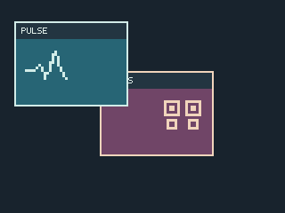
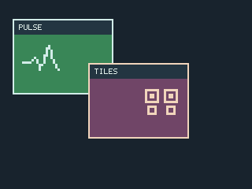
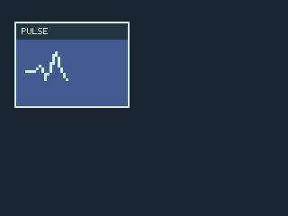

# CHG-338 · Resident Wayland compositor / JNOX 상주 Wayland 합성기

REQ-015/024 · DES-009/013 · VER-015/024. Package the compositor, two client programs and the local socket broker in separate ordinary AArch64 address spaces. Only the compositor owns the framebuffer and input. Clients write pixels into their own shared backing, derive a read-only descriptor, and transfer it over AF_UNIX to the compositor. [Resident window-system acceptance #412](https://github.com/Romanof123/JNOX/issues/412) · [Compositor acceptance #446](https://github.com/Romanof123/JNOX/issues/446) · [Descriptor transfer #444](https://github.com/Romanof123/JNOX/issues/444)

## Protocol and resource ownership

The compositor advertises a fixed `wl_output` through v3 for its 320×240 RAM framebuffer. Geometry has origin (0,0), normal transform, unknown subpixel arrangement, and make/model “JNOX” / “RAM framebuffer”. Unknown physical millimeters and refresh in mHz are zero. The sole mode is current and preferred. Each v1 binding receives geometry and mode. A v2 or v3 binding also receives scale 1 and done. Surface membership follows the transformed, scaled buffer’s intersection with the actual framebuffer, including committed geometry and attachment offsets. A late bind receives its description before enter; releasing a v3 binding retires its client-local object ID. A valid bound output or NULL may be supplied as a fullscreen preference. The compositor’s existing windowed layout policy answers with a configure.

이 합성기는 320×240 RAM 프레임버퍼를 `wl_output` v3까지 제공한다. 물리 크기와 주사율은 알 수 없어 0으로 전송하고, 유일한 모드는 현재·선호 모드로 표시한다. v2 이상에서는 배율 1과 done을 추가한다. 변환, 배율, 창 지오메트리와 버퍼 위치를 적용한 실제 사각형이 화면에 들어오거나 빠질 때 해당 연결이 바인딩한 출력 객체로만 enter/leave를 전달한다. 이미 표시된 창에서 출력을 나중에 바인딩해도 출력 설명 다음에 enter가 온다. v3 release로 클라이언트 객체 ID를 반환한다. 전체 화면 선호 요청에는 같은 클라이언트의 출력 또는 NULL을 허용하며 기존 창 배치 정책에 따라 configure를 보낸다.

Trace for #448 follows compositor CHG-338 / IMP-338, REQ-015/024, DES-009/013 and VER-015/024. The output cases exercise the protocol and renderer on the Linux host adapter. The historical EVD-338 run predates this global. [Pinned protocol inputs](../verification/wayland/upstream.json) · [Host verification profiles](../verification/wayland/README.md)

A new connection starts with its own `wl_display` object. Expose `wl_registry`, `wl_compositor` through version 4, `wl_shm` version 1, `xdg_wm_base` version 1 and `wl_seat` through version 4. Bind the lesser of the client and advertised versions. Decode complete little-endian wire messages on this target and queue received descriptors separately in stream order. A single receive can hold part of a header, multiple messages or an FD for a later message. Separate independent connections may use identical object IDs. Verify types, object lifetime, sizes, offsets, stride and formats before use. A protocol violation terminates the offending connection. [Wayland wire format](https://wayland.freedesktop.org/docs/book/Protocol.html) · [Wayland core protocol](https://wayland.freedesktop.org/docs/html/apa.html)

Create a pool by mapping the transferred backing, then create buffers as ranges within that pool. Retain the shared mapping while a live buffer needs it. An initial empty surface commit leads to toplevel and xdg-surface configure events. The client acknowledges the serial before attaching pixels. Maintain pending and committed surface state. Send `wl_buffer.release` once the compositor has finished reading the buffer. Send frame callbacks and retire callback IDs according to their wire lifetime. Keymaps use an actual readable file descriptor and the XKB format. Route pressed and released keys and focus changes to live keyboard objects belonging to the appropriate client.

## Verification

1. Build a Linux reference client with the distribution's unmodified libwayland-client and generated stable xdg-shell bindings. Exercise the same compositor dispatch code through a Linux Unix-socket backend. Record library and XML digests and native/display backend differences.
2. Cold-boot JNOX with the native backend, two independent clients and the AF_UNIX broker. Observe overlap, focus changes, two independent client-rendered buffers, frame callbacks and buffer release. A focused client exits with outstanding work. Capture the surviving surface processing new input. Compare full external frames, private client memory and backing permissions.
3. Track compositor restart and continued headless control separately, including re-binding the endpoint, fresh object namespaces, old FD cleanup and a measured timing bound. The four-role display run does not by itself exercise a fifth independent control workload. Run Xwayland itself with the named X11 client and a native window under #412. Physical input, panel and interference qualification require the selected hardware.

The selected reference XML files are from Ubuntu Jammy packages. SHA-256 for core 1.20.0 is `e20d8e766908e56828b3d39d20968382a3e725cfbca97bbbf0bbfab956cc7455`. SHA-256 for stable xdg-shell from wayland-protocols 1.25 is `637877607a10bcff2f33722d2607ab1edb53ff70325e9df46372c1afd811af43`.

## 한국어 설계와 검증

JNOX 게스트 안에서 화면·입력을 소유한 합성기 한 개, 서로 격리된 앱 두 개, 로컬 소켓 브로커를 실행한다. 앱은 자신이 쓴 픽셀을 읽기 전용 FD로 보내고, 합성기는 버퍼가 가리키는 범위와 권한을 확인한다. 앱마다 객체 ID 공간을 따로 관리한다. 수신 메시지가 나뉘거나 여러 메시지가 붙어 도착해도 FD는 순서대로 올바른 요청에 연결한다.

앱이 초기 설정 이벤트에 응답한 뒤 제출한 버퍼를 화면에 표시하고 읽기가 끝나면 반환을 알린다. 두 창이 겹친 상태에서 포커스를 바꾸고 실제 키를 입력한다. 한 앱이 버퍼를 제출한 직후 종료해도 다른 앱이 계속 화면을 갱신해야 한다. 표준 클라이언트 라이브러리와 호스트에서 확인한 프로토콜 호환, JNOX 게스트의 실행 결과, 합성기 재시작 중 제어 태스크의 연속 실행을 각각 기록한다.

## EVD-338 · Native guest results / 게스트 검증 결과

Two cold boots displayed the same six states. Pulse processed input, Tiles took focus and processed its own input, then Tiles exited with work outstanding. Pulse continued rendering and shut down through the standard toplevel close event. Both boots exited with status 0, 71, 72 and 0 for the compositor, Pulse, Tiles and the broker. Two host runs used Ubuntu libwayland-client and libxkbcommon and located all 320 client pixels at (16,24) and (13,22) after an offset window geometry. The host and native backends share the compositor dispatcher. [Originals, replay and limitations](evidence/native-wayland-compositor/README.md) · [PR #450](https://github.com/Romanof123/JNOX/pull/450) · [Restart acceptance #449](https://github.com/Romanof123/JNOX/issues/449)

| Initial overlap / 처음 겹친 창 | Focus on Tiles / Tiles 포커스 | Pulse after Tiles exit / 종료 뒤 Pulse |
|---|---|---|
|  |  |  |

두 부팅에서 앱별 객체 ID, configure와 ack 순서, SHM 권한 전달, 버퍼 반환, 키 입력 전달, 클라이언트 종료 후 남은 앱의 화면을 독립 판독했다. 원본 UART 고정 기록에는 각각 11,708건과 11,884건의 누락이 있어 전체 이벤트 순서는 소켓 바이트·정지된 메모리·외부 화면을 함께 사용해 확인했다. 게스트 키맵의 원문 바이트, 실보드 화면과 장애 후 합성기 재시작은 별도 범위다.
